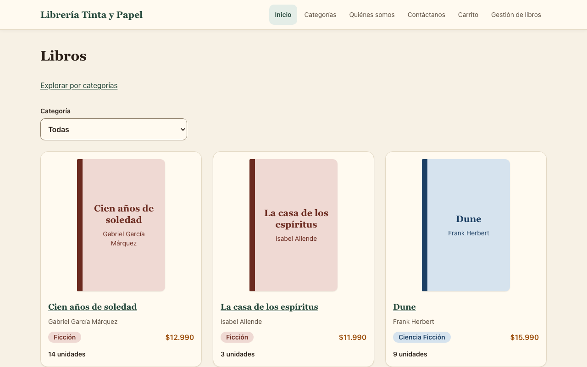
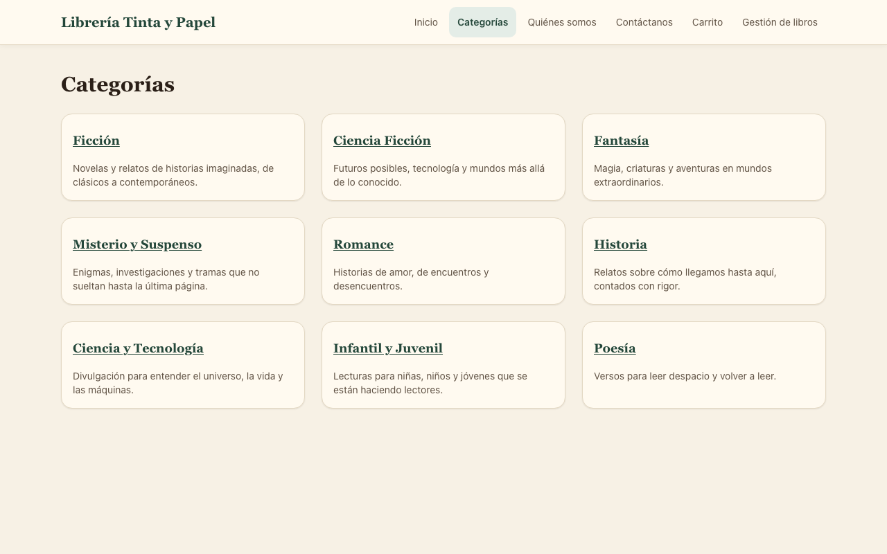
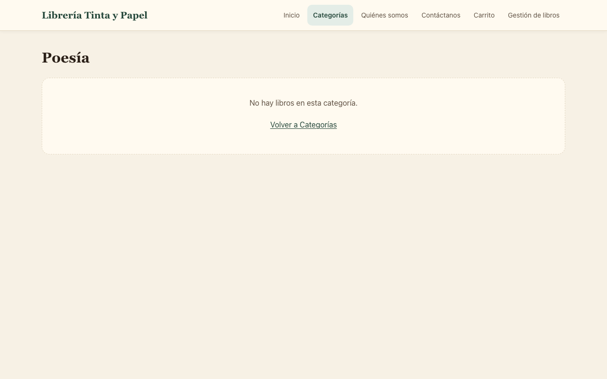
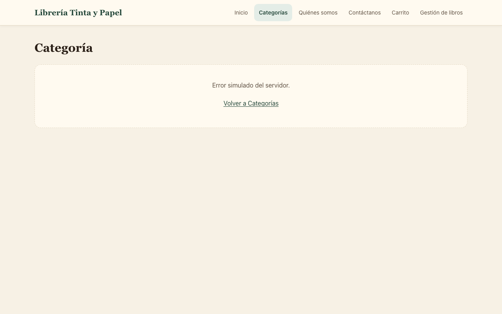
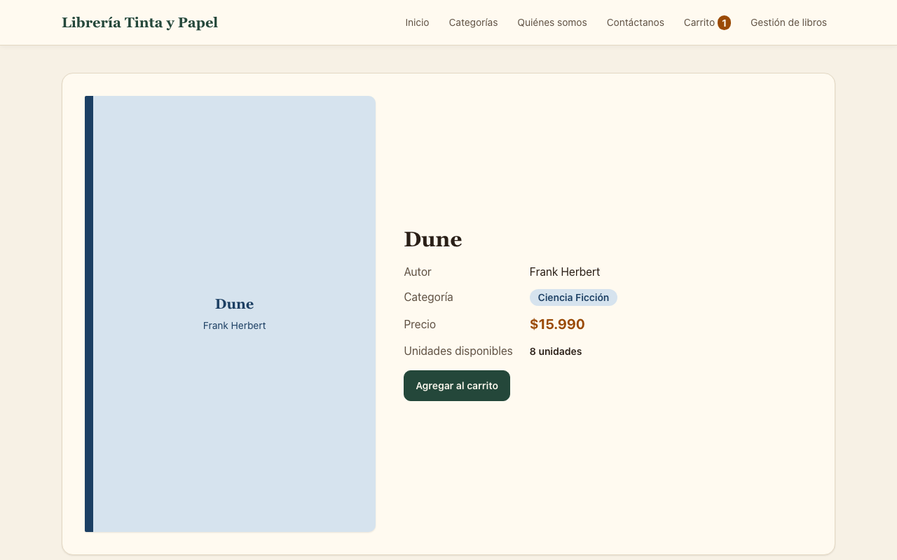

# Librería Tinta y Papel

Tienda de libros. Muestra un catálogo de libros por categoría, el detalle de cada libro, un carrito y la gestión del inventario. Los datos viven en memoria y se reinician al recargar.

## Stack

- React 19 con Create React App (`react-scripts`)
- React Router
- Tailwind CSS
- API mock con MSW: REST (categorías) y GraphQL (libros)

## Rutas

| Ruta | Pantalla |
|---|---|
| `/` | Catálogo con filtro por categoría |
| `/libros/:bookId` | Detalle del libro |
| `/categorias` | Lista de categorías (API mock) |
| `/categorias/:slug` | Libros de una categoría (API mock) |
| `/carrito` | Carrito |
| `/quienes-somos`, `/contacto` | Información de la librería |
| `/gestion-libros/agregar-libro` | Formulario para agregar un libro |
| `/gestion-libros/inventario-libros` | Tabla de libros con eliminación |
| cualquier otra | Página 404 |

## Requisitos

- Node.js según la versión indicada en `.nvmrc`
- npm

## Instalación y ejecución

```bash
npm ci          # instala las dependencias
npm start       # servidor de desarrollo en http://localhost:3000/libreria-gustavo-dominguez-pfy2202/
npm test        # pruebas en modo interactivo
npm run build   # build de producción en la carpeta build/
```

## API mock

La app consume APIs simuladas con [MSW](https://mswjs.io) que corren en el navegador (service worker). REST sirve las categorías y GraphQL gestiona los libros; ambas comparten un único almacén en memoria. Están activas por defecto, también en el sitio publicado.

| Petición | Respuesta |
|---|---|
| `GET /api/categories` | Las 9 categorías (`id`, `slug`, `name`, `description`) |
| `GET /api/books?category=<slug>` | Libros de la categoría; `[]` si no tiene (p. ej. `poesia`); 404 si el slug no existe; 400 si falta `category` |

- **Desactivarla:** compila con `REACT_APP_USE_MOCKS=false` (ver `.env.example`). Si ya visitaste el sitio con el mock activo, des-registra el service worker en DevTools → Application → Service Workers.
- **Probar un error 500 (solo en desarrollo):** con `npm start`, abre `/libreria-gustavo-dominguez-pfy2202/categorias/error-500`. En el build publicado ese slug responde 404.
- **Datos en memoria:** los libros agregados o eliminados se ven en todas las pantallas, incluidas las de categoría (REST). Al recargar la página el almacén vuelve a los datos semilla.

### API GraphQL (`POST /graphql`)

```graphql
type Category { id: ID!  slug: String!  name: String!  description: String! }
type Book { id: ID!  title: String!  author: String!  category: Category!  price: Int!  stock: Int! }
input AddBookInput { title: String!  author: String!  categoryId: ID!  price: Int!  stock: Int! }
type Query { books(category: String): [Book!]!  book(id: ID!): Book }
type Mutation { addBook(input: AddBookInput!): Book!  deleteBook(id: ID!): Book! }
```

- Las operaciones usadas son `Books`, `Book`, `AddBook` y `DeleteBook`.
- La validación responde HTTP 200 con `errors[]`; cada error de campo trae `extensions.field` (`title`, `author`, `categoryId`, `price`, `stock`).
- Agregar un libro con el mismo título, autor y categoría suma el stock al existente.
- Las unidades que se muestran son el stock del servidor menos las unidades en el carrito; eliminar un libro también lo quita del carrito.
- **Errores simulados (solo en desarrollo):** `books(category: "error-500")`, `addBook` con título `error-500`, o `localStorage.mockFailOperation = "<Operación>"` (por ejemplo `Books` o `DeleteBook`). En el build publicado se ignoran.
- `npm start` sirve la app bajo `/libreria-gustavo-dominguez-pfy2202/` (por el campo `homepage`).

## Capturas

| Inicio | Categorías |
|---|---|
|  |  |

| Categoría sin libros | Error de la API |
|---|---|
|  |  |



## Publicación

El sitio se publica en [https://gustavoduocuc.github.io/libreria-gustavo-dominguez-pfy2202](https://gustavoduocuc.github.io/libreria-gustavo-dominguez-pfy2202).

- El workflow `.github/workflows/deploy.yml` corre en cada push a `main` (o a mano desde la pestaña Actions): instala, prueba, construye con `PUBLIC_URL=/libreria-gustavo-dominguez-pfy2202` y publica `build/` en la rama `gh-pages`.
- En Settings → Pages la fuente debe ser **Deploy from a branch → `gh-pages` / `(root)`**.
- `postbuild` copia `index.html` a `404.html` para que las rutas profundas (por ejemplo `/categorias/ficcion`) funcionen al refrescar; GitHub Pages las responde con código 404 pero la app se muestra.
